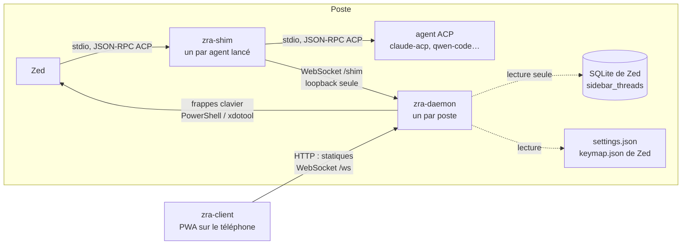

# ZRA — architecture

ZRA (Zed Remote Agent) permet de suivre et de piloter depuis un téléphone les threads d'agents ACP ouverts dans l'éditeur Zed : liste des threads, flux en direct, envoi de messages, réponses aux permissions, ouverture d'une session.

Ce document donne la carte. Le détail est ailleurs : `SPEC.md` (spécification et décisions), `PROTOCOL.md` (protocole PWA ↔ daemon), `DEPLOY.md` (mise en service).

## Vue d'ensemble

## Les trois composants

| Composant | Rôle | Durée de vie |
|---|---|---|
| `zra-shim/` | Proxy ACP. Zed le lance à la place de l'agent (entrée `claude-zra` de `agent_servers`), il lance le vrai agent et recopie les trames dans les deux sens. Il observe le flux, le publie au daemon, et injecte ce qui vient du mobile. | Celle du thread dans Zed |
| `zra-daemon/` | Serveur HTTP + WebSocket du poste. Tient l'index des threads, route les messages entre shims et clients, gère l'appairage, pilote la fenêtre Zed au clavier. | Long-running, un par poste |
| `zra-client/` | PWA en JavaScript natif, sans build. Servie par le daemon. Peut suivre plusieurs postes. | Navigateur du téléphone |

`scripts/` porte l'installation (`setup`), le service (`service`), l'appairage (`pair`) et la mise au point du clavier (`zed`).

## Les échanges

### Zed ↔ shim ↔ agent : stdio ACP

- Trames JSON-RPC délimitées par un saut de ligne (`zra-shim/framing.js`).
- `zra-shim/proxy.js` recopie chaque trame **octet pour octet**. L'observation est entourée d'un `try/catch` : une erreur d'analyse ne bloque jamais le relais.
- `zra-shim/acp.js` (`AcpBridge`) fait quatre choses en plus du relais :
  - il envoie à l'agent des requêtes à lui (`session/prompt`, `session/set_mode`…), d'identifiant `zra-N`, et retire leurs réponses du flux vers Zed ;
  - il envoie à Zed un `user_message_chunk` synthétique pour qu'un message du mobile s'affiche dans Zed ;
  - il répond à l'agent à la place de Zed quand le mobile tranche une permission, puis retire la réponse tardive de Zed ;
  - il tient la file d'attente des messages et un garde-fou de tour (`zra-shim/queue.js`, 10 min de silence par défaut).

### Shim ↔ daemon : WebSocket `/shim`

- Le shim se connecte à `ws://127.0.0.1:<port>/shim` et se reconnecte seul (`zra-shim/daemon-link.js`). Le daemon refuse ce chemin hors loopback.
- Shim → daemon : `shim_hello`, `session`, `acp_update`, `state`, `session_replay`, `permission_resolved`, `permission_expired`, `notice`, `ack`.
- Daemon → shim : `cmd` (`prompt`, `cancel`, `set_option`, `respond_permission`, `cancel_queued`), acquitté par `ack`.
- Côté daemon : `zra-daemon/shim-link.js` (`ShimHost`) et `zra-daemon/shim-registry.js`.

### PWA ↔ daemon : HTTP et WebSocket `/ws`

- Même port pour tout (7777 par défaut). HTTP sert `zra-client/` (`zra-daemon/static.js`).
- WebSocket : protocole décrit dans `PROTOCOL.md`. `zra-daemon/hub.js` est le seul module qui connaît les clients.
- Les événements ACP sont rediffusés tels quels dans des `acp_event` numérotés (`seq`). Un tampon circulaire par thread (`zra-daemon/ring-buffer.js`, 2 000 événements) permet de reprendre après une coupure.
- Routes HTTP réservées à la loopback : `/status`, `/pair`, `/pair/rotate`, `/pair/revoke` (utilisées par `npm run setup` et `npm run pair`).

## Flux de données principaux

| Flux | Chemin |
|---|---|
| Liste des threads | `threads-index.js` lit la table `sidebar_threads` toutes les 2 s → `hub` → message `threads` |
| Flux en direct | agent → shim (`session/update`) → `acp_update` → `ShimHost` → `hub.publish` → tampon + `acp_event` aux abonnés |
| Historique d'un thread fermé | `session-loader.js` lance une seconde instance de l'agent, appelle `session/load`, collecte le replay, met en cache 10 min |
| Message du mobile | `send` → `hub` → backend d'injection (`inject/acp.js`) → `cmd prompt` → le shim émet `session/prompt` vers l'agent |
| Thread fermé, puis message | `zed/control.js` rouvre le thread dans Zed au clavier, attend que son shim annonce la session, puis injecte |
| Nouvelle session (« + ») | `zed/driver.js` ouvre le projet avec la CLI de Zed, puis envoie la touche liée à l'agent dans `keymap.json` |
| Permission | l'agent demande → le shim publie → le premier qui répond (Zed ou mobile) gagne, le shim arbitre |

Backends d'injection (`zra-daemon/inject/`) : `acp` (défaut, le shim émet le prompt), `uia` (le texte est tapé au clavier dans Zed), `auto` (`acp`, repli clavier), `mock` (bouchon de test).

## Sécurité : où sont les contrôles

- Écoute : loopback, IPv4 privées du poste, interface de tunnel reconnue. Jamais `0.0.0.0` (`zra-daemon/net.js`).
- `Origin` du WebSocket `/ws` : liste exacte, origines propres du daemon ajoutées d'office (`zra-daemon/server.js`).
- Appairage hors loopback : code à 6 chiffres contre un jeton, stocké haché dans `.zra/auth.json` (`zra-daemon/auth.js`). La loopback en est dispensée.
- Pilotage clavier : désactivé par défaut (`zedControl.enabled`), vérification du premier plan avant chaque étape (`zra-daemon/zed/keyboard.js`, `keyboard.ps1`).

## Dépendances externes

| Dépendance | Usage | Si elle change |
|---|---|---|
| Base SQLite de Zed (`db/0-stable/db.sqlite`, tables `sidebar_threads`, `workspaces`, `kv_store`) | Index des threads, projets ouverts | Colonne requise absente : mode dégradé « live seul », signalé à la PWA |
| `settings.json` de Zed (`agent_servers`) et son registry d'agents | Savoir lancer un agent, y inscrire les entrées ZRA | `setup` refuse d'écrire si le fichier n'est pas un JSONC valide |
| `keymap.json` de Zed (action `agent::NewExternalAgentThread`) | Touche « nouveau thread » par agent | La touche n'a plus d'effet : erreur explicite après 30 s |
| Palette de commandes et sidebar de Zed | Recettes clavier (`zed/driver.js`) | Recettes surchargeables dans `zedControl.recipes` |
| Protocole ACP | Méthodes `session/*`, `session/update`, `session/request_permission` | Le relais continue ; observation et injection à revoir |
| Node ≥ 24 | `node:sqlite`, `WebSocket` global | Imposé par `engines` et `.npmrc` |
| Windows : PowerShell, `schtasks` ; Linux : `xdotool`, `pgrep`, systemd ou autostart XDG | Clavier, service | Détection centralisée dans `zra-daemon/platform.js` |

Aucune dépendance npm en production. En développement : `jsdom` et `jsqr` (tests).

## Installation et service

1. `npm run setup install apply` (`scripts/setup.mjs`) : ajoute une entrée par agent dans `agent_servers`, un bloc de raccourcis balisé dans `keymap.json`, et sous Wayland modifie le `.desktop` de Zed pour forcer XWayland. Simulation par défaut ; sauvegardes dans `.zra/backups/`.
2. `npm run daemon` : lit `zra.config.json` (facultatif, modèle dans `zra.config.example.json`).
3. `npm run service -- install --apply` (`scripts/service.mjs`) : tâche planifiée Windows, unité `systemd --user`, ou entrée autostart XDG. Toujours au niveau de l'utilisateur, sans élévation.
4. `npm run setup -- uninstall --apply` et `npm run service -- uninstall --apply` défont les deux.

Les entrées écrites dans Zed et dans le service contiennent le chemin absolu du dépôt et de Node.

État local : `.zra/` dans le dépôt (jetons hachés, journaux, sauvegardes, trames enregistrées) et le dossier d'application (`%LOCALAPPDATA%\zra` ou `$XDG_STATE_HOME/zra`) pour le journal des injections.

## Par où commencer

| Pour comprendre… | Lire |
|---|---|
| Le démarrage et le câblage du daemon | `zra-daemon/index.js`, `zra-daemon/daemon.js` |
| Le protocole côté serveur | `zra-daemon/hub.js`, avec `PROTOCOL.md` |
| Le relais et l'injection ACP | `zra-shim/index.js`, `zra-shim/acp.js` |
| L'état d'un thread côté client | `zra-client/js/store.js`, `zra-client/js/acp.js` |
| Le rendu | `zra-client/js/views/thread.js`, `views/entry.js`, `markdown.js` |
| Les chemins et outils par OS | `zra-daemon/platform.js` |
| Un scénario de bout en bout sans Zed | `zra-daemon/test/lot-b.test.mjs` (vrai daemon, vrai shim, agent bouchon) |

Tester sans Zed : `npm run daemon:dev -- --injection mock`, ou `npm run mock` (serveur bouchon de la PWA). Tests : `npm test` (environ 70 s).
