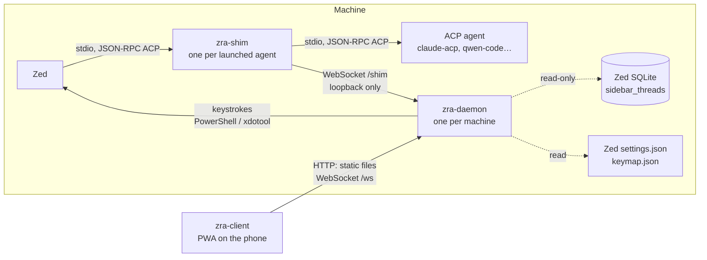

# ZRA — architecture

ZRA (Zed Remote Agent) lets you follow and drive, from a phone, the ACP agent threads open in the Zed editor: thread list, live stream, sending messages, answering permissions, opening a session.

The details are elsewhere: `docs/en/protocol.md` (PWA ↔ daemon protocol), `docs/en/deploy.md` (setup), `docs/en/daemon.md`, `docs/en/shim.md`, `docs/en/client.md` (one component each), `docs/en/zed.md` (mapping to Zed).

## Principle

ZRA relays what passes between Zed and the agent as is, and adds what comes from the phone. Anything Zed can display, the PWA can display: no per-agent adapter, no proprietary format read, no diff computed by ZRA (diffs, terminals and statuses are already in ACP). The shim is **fail-open**: daemon missing or slow, it stays a transparent pipe; ZRA must never break Zed.

Out of scope: replacing Zed's panel on desktop, editing code on mobile, running an agent without Zed.

## Overview

## The three components

| Component | Role | Lifetime |
|---|---|---|
| `zra-shim/` | ACP proxy. Zed launches it instead of the agent (`claude-zra` entry in `agent_servers`), it launches the real agent and copies frames both ways. It observes the stream, publishes it to the daemon, and injects what comes from the phone. | That of the thread in Zed |
| `zra-daemon/` | The machine's HTTP + WebSocket server. Holds the thread index, routes messages between shims and clients, handles pairing, drives the Zed window with the keyboard. | Long-running, one per machine |
| `zra-client/` | PWA in plain JavaScript, no build. Served by the daemon. Can follow several machines. | The phone's browser |

`scripts/` holds installation (`setup`), the service (`service`), pairing (`pair`) and keyboard tuning (`zed`).

## The exchanges

### Zed ↔ shim ↔ agent: stdio ACP

- Newline-delimited JSON-RPC frames (`zra-shim/framing.js`).
- `zra-shim/proxy.js` copies each frame **byte for byte**. Observation is wrapped in a `try/catch`: a parsing error never blocks the relay.
- `zra-shim/acp.js` (`AcpBridge`) does four things on top of the relay:
  - it sends the agent requests of its own (`session/prompt`, `session/set_mode`…), with a `zra-N` id, and removes their answers from the stream to Zed;
  - it sends Zed a synthetic `user_message_chunk` so that a message from the phone shows up in Zed;
  - it answers the agent on Zed's behalf when the phone settles a permission, then removes Zed's late answer;
  - it holds the message queue and a turn watchdog (`zra-shim/queue.js`, 10 min of silence by default).

### Shim ↔ daemon: WebSocket `/shim`

- The shim connects to `ws://127.0.0.1:<port>/shim` and reconnects on its own (`zra-shim/daemon-link.js`). The daemon refuses this path outside loopback.
- Shim → daemon: `shim_hello`, `session`, `acp_update`, `state`, `session_replay`, `permission_resolved`, `permission_expired`, `notice`, `ack`.
- Daemon → shim: `cmd` (`prompt`, `cancel`, `set_option`, `respond_permission`, `cancel_queued`), acknowledged by `ack`.
- Daemon side: `zra-daemon/shim-link.js` (`ShimHost`) and `zra-daemon/shim-registry.js`.

### PWA ↔ daemon: HTTP and WebSocket `/ws`

- Same port for everything (7777 by default). HTTP serves `zra-client/` (`zra-daemon/static.js`).
- WebSocket: protocol described in `docs/en/protocol.md`. `zra-daemon/hub.js` is the only module that knows the clients.
- ACP events are rebroadcast as is in numbered `acp_event`s (`seq`). A ring buffer per thread (`zra-daemon/ring-buffer.js`, 2,000 events) allows resuming after a drop.
- HTTP routes reserved to loopback: `/status`, `/pair`, `/pair/rotate`, `/pair/revoke` (used by `npm run setup` and `npm run pair`).

## Main data flows

| Flow | Path |
|---|---|
| Thread list | `threads-index.js` reads the `sidebar_threads` table every 2 s → `hub` → `threads` message |
| Live stream | agent → shim (`session/update`) → `acp_update` → `ShimHost` → `hub.publish` → buffer + `acp_event` to subscribers |
| History of a closed thread | `session-loader.js` launches a second agent instance, calls `session/load`, collects the replay, caches it 10 min |
| Message from the phone | `send` → `hub` → injection backend (`inject/acp.js`) → `cmd prompt` → the shim sends `session/prompt` to the agent |
| Closed thread, then a message | `zed/control.js` reopens the thread in Zed with the keyboard, waits for its shim to announce the session, then injects |
| New session ("+") | `zed/driver.js` opens the project with the Zed CLI, then sends the key bound to the agent in `keymap.json` |
| Permission | the agent asks → the shim publishes → the first to answer (Zed or phone) wins, the shim arbitrates |

Injection backends (`zra-daemon/inject/`): `acp` (default and the only supported one, the shim sends the prompt), `uia` and `auto` (experimental: the text is typed into Zed with the keyboard), `mock` (test stub).

## Zed

What ZRA reads, writes and imitates in Zed, with where to check it in its sources: `docs/en/zed.md`.

Thread states: **live** (a shim holds its session: real-time stream, direct writing), **closed** (in the index, without a shim: history through `session/load`, writing after reopening in Zed), **unknown** (null `session_id`: shown greyed out, never hidden).

## Behaviors

- **Queue and interruption**: the turn (`idle`/`busy`) and the queue live in the shim, the only one to see the real traffic. A message during a turn is queued; Stop sends `session/cancel`, then the queue resumes. A turn is closed by force if the agent does not acknowledge an interruption within 5 s or stays silent for `turnTimeoutMs` (10 min); the queue is then not dequeued.
- **Options** (mode, model, other `configOptions`): never in the middle of a turn, applied on the return to `idle`.
- **Permissions**: the first to answer (Zed or phone) wins. The shim answers the agent on Zed's behalf and swallows Zed's late answer.
- **Closed thread**: replayed by an agent instance launched for the occasion (`session/load`, 10 min cache). To write to it, the daemon reopens it in Zed with the keyboard, waits for its shim (30 s), then injects: a single session, no divergence. A thread of an agent not wrapped by ZRA is refused (`not_zra_thread`).
- **New session**: a project's **+** opens that project through the Zed CLI, then plays the agent's "new thread" key (`keymap.json`) in its window. The first new `session_id` announced by a shim becomes `thread_created` (30 s).

## Security: where the controls are

- Listening: loopback, the machine's private IPv4 addresses (except networks marked "Public" on Windows), a recognized tunnel interface. Never `0.0.0.0` (`zra-daemon/net.js`).
- `Origin` of the `/ws` WebSocket: exact list, the daemon's own origins added automatically (`zra-daemon/server.js`).
- Pairing outside loopback: a 6-digit code exchanged for a token, stored hashed in `.zra/auth.json` (`zra-daemon/auth.js`). Locked after 10 failures. Loopback is exempt, except for a request relayed by a local proxy.
- Keyboard control: enabled by default, can be disabled (`zedControl.enabled`), foreground check before each step (`zra-daemon/zed/keyboard.js`, `keyboard.ps1`).

## External dependencies

| Dependency | Use | If it changes |
|---|---|---|
| Zed SQLite database (`db/0-<channel>/db.sqlite`, tables `sidebar_threads`, `workspaces`, `kv_store`) | Thread index, open projects | Required column missing: degraded "live only" mode, reported to the PWA |
| Zed `settings.json` (`agent_servers`) and its agent registry | Knowing how to launch an agent, adding the ZRA entries | `setup` refuses to write if the file is not valid JSONC |
| Zed `keymap.json` (action `agent::NewExternalAgentThread`) | "New thread" key per agent | The key no longer has an effect: explicit error after 30 s |
| Zed command palette and sidebar | Keyboard recipes (`zed/driver.js`) | Recipes can be overridden in `zedControl.recipes` |
| ACP protocol | `session/*`, `session/update`, `session/request_permission` methods | The relay keeps working; observation and injection to be reviewed |
| Node ≥ 24 | `node:sqlite`, global `WebSocket` | Enforced by `engines` and `.npmrc` |
| Windows: PowerShell, `schtasks`; Linux: `xdotool`, `pgrep`, systemd or XDG autostart | Keyboard, service | Detection centralized in `zra-daemon/platform.js` |

No npm dependency in production. In development: `jsdom` and `jsqr` (tests).

## Installation and service

1. `npm run setup install apply` (`scripts/setup.mjs`): adds one entry per agent in `agent_servers`, a tagged block of shortcuts in `keymap.json`, and under Wayland edits the Zed `.desktop` to force XWayland. Dry run by default; backups in `.zra/backups/`.
2. `npm run daemon`: reads `zra.config.json` (optional, template in `zra.config.example.en.json`).
3. `npm run service -- install --apply` (`scripts/service.mjs`): Windows scheduled task, `systemd --user` unit, or XDG autostart entry. Always at user level, without elevation.
4. `npm run setup -- uninstall --apply` and `npm run service -- uninstall --apply` undo both.

The entries written into Zed and into the service contain the absolute path of the repository and of Node.

Local state: `.zra/` in the repository (hashed tokens, logs, backups, frames recorded with `--record`) and the application folder (`%LOCALAPPDATA%\zra` or `$XDG_STATE_HOME/zra`) for the injection log.

## Weak spots

- **The shim is not passive.** It starts turns Zed did not ask for, announces to Zed messages it did not send, settles permissions in its place and force-closes a turn silent for 10 min. Zed's state and the agent's can therefore diverge; two simultaneous prompts (Zed and phone) on the same session depend on the agent's behavior.
- **Replaying a closed thread launches a second agent** on the machine (`session-loader.js`).
- **The keyboard is the fragile part**: real keystrokes in Zed's palette, hard-coded labels (`zed/driver.js`). The only part that can write in the wrong place.

What breaks if Zed changes, from most to least likely:

1. palette labels or the `agent::NewExternalAgentThread` action: no more "+" nor reopening, explicit error after 30 s;
2. `sidebar_threads` schema or `db/0-<channel>` path: degraded "live only" mode, reported;
3. format of `agent_servers` or of the agent registry: `setup` and history replay fail;
4. ACP: the relay keeps working, observation and injection to be reviewed in `zra-shim/acp.js`.

To preserve: byte-for-byte relay with isolated observation, installation as a dry run by default, refusal of the real keyboard under test, exact `Origin` check.

## Decisions

Settled, not to be reopened without a new fact:

- **Threat model**: trusted local network, except a network marked "Public" (Windows: no listening; tunnels excluded). Linux: `lanCidrs`.
- **Pairing**: single-use code, locked after 10 failures across all devices; `npm run pair` reopens it.
- **Unpaired connections**: capped (8 per IP, 64 in total, cut at 120 s, 64 KB buffer).
- **`zedControl.enabled`**: `true` by default (the "+" and reopening depend on it), warning at startup; `false` remains possible.
- **Stack**: JavaScript ESM + JSDoc, Node ≥ 24, zero build, zero runtime dependency.
- **History**: `session/load`, never reading an agent's proprietary format.
- **Injection**: only `acp` supported; `uia`, `auto` and `wireguard` kept as experimental.
- **Frame recording**: disabled by default, `npm run setup -- install --record` for debugging.
- **Flatpak / Snap**: not supported (`docs/en/limitations.md`).
- **`-ExecutionPolicy Bypass`**: kept, limited to the launched process (`docs/en/deploy.md` §5).

## Checking a machine

On a new machine, after a Zed update or with a new agent. In order; if something goes wrong, read `.zra/logs/shim.log` first.

1. `npm test` passes; `npm run probe:agent <agent>` does the handshake with the real agent through the shim.
2. `npm run setup install apply`, then `npm run setup`: ZRA entries, resolved agents, keys in the keymap.
3. In Zed, a thread with the ZRA entry behaves as with the original agent.
4. `npm run daemon:dev`: the thread is **live** on `http://localhost:7777`, a prompt sent from Zed streams there.
5. A message sent from the PWA goes out and shows on both sides; a closed thread opens with its history.
6. In a live thread: queue during a turn, Stop, mode and model, permission settled from the PWA then from Zed.
7. Zed control: `npm run zed -- probe`, a project's **+**, reopening a closed thread (`npm run zed -- try <recipe>` for tuning).
8. Phone (`docs/en/deploy.md`): pairing, revocation, tunnel, network change, service, HTTPS.

## Where to start

| To understand… | Read |
|---|---|
| Daemon startup and wiring | `zra-daemon/index.js`, `zra-daemon/daemon.js` |
| The protocol, server side | `zra-daemon/hub.js`, with `docs/en/protocol.md` |
| ACP relay and injection | `zra-shim/index.js`, `zra-shim/acp.js` |
| A thread's state, client side | `zra-client/js/store.js`, `zra-client/js/acp.js` |
| Rendering | `zra-client/js/views/thread.js`, `views/entry.js`, `markdown.js` |
| Paths and tools per OS | `zra-daemon/platform.js` |
| An end-to-end scenario without Zed | `zra-daemon/test/e2e-shim.test.mjs` (real daemon, real shim, stub agent) |

Testing without Zed: `npm run daemon:dev -- --injection mock`, or `npm run mock` (PWA stub server). Tests: `npm test` (about 70 s).
