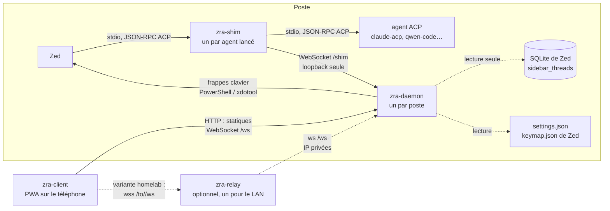

# ZRA — architecture

ZRA (Zed Remote Agent) permet de suivre et de piloter depuis un téléphone les threads d'agents ACP ouverts dans l'éditeur Zed : liste des threads, flux en direct, envoi de messages, réponses aux permissions et aux questions de l'agent, ouverture d'une session.

Le détail est ailleurs : `docs/fr/protocol.md` (protocole PWA ↔ daemon), `docs/fr/deploy.md` (mise en service), `docs/fr/daemon.md`, `docs/fr/shim.md`, `docs/fr/client.md` (un composant chacun), `docs/fr/zed.md` (correspondance avec Zed).

## Principe

ZRA relaie tel quel ce qui passe entre Zed et l'agent, et y ajoute ce qui vient du mobile. Tout ce que Zed sait afficher, la PWA peut l'afficher : aucun adaptateur par agent, aucun format propriétaire lu, aucun diff calculé côté ZRA (diffs, terminaux et statuts sont déjà dans ACP). Le shim est **fail-open** : daemon absent ou lent, il reste un tuyau transparent ; ZRA ne doit jamais casser Zed.

Hors périmètre : remplacer le panneau de Zed sur desktop, éditer du code sur mobile, faire tourner un agent sans Zed.

## Vue d'ensemble

## Les composants

| Composant | Rôle | Durée de vie |
|---|---|---|
| `zra-shim/` | Proxy ACP. Zed le lance à la place de l'agent — preload node dans l'entrée `registry` d'origine (agents npx), ou entrée `… (zra)` de `agent_servers` (binaires) —, il lance le vrai agent et recopie les trames dans les deux sens. Il observe le flux, le publie au daemon, et injecte ce qui vient du mobile. | Celle du thread dans Zed |
| `zra-daemon/` | Serveur HTTP + WebSocket du poste. Tient l'index des threads, route les messages entre shims et clients, gère l'appairage, pilote la fenêtre Zed au clavier. | Long-running, un par poste |
| `zra-client/` | PWA en JavaScript natif, sans build. Servie par le daemon, par le relais ou par tout serveur statique. Peut suivre plusieurs postes. | Navigateur du téléphone |
| `zra-relay/` | Relais HTTPS optionnel (`npm run relay`), pour le homelab : sert la PWA et relaie `wss://<hôte>/to/<ip>[:<port>]/ws` → `ws://<ip>:<port>/ws` (7777 par défaut), en pipe transparent. IP privées littérales uniquement ; la requête vers le poste part sans `Origin` (client natif pour le daemon : rien à déclarer sur les postes). L'appairage traverse de bout en bout. HTTP derrière le proxy du homelab, ou HTTPS autonome (`ZRA_RELAY_TLS_CERT`/`KEY`, relu à chaud). | Long-running, un pour le LAN, optionnel |

`scripts/` porte l'installation (`setup`), le service (`service`), l'appairage (`pair`) et la mise au point du clavier (`zed`).

## Les échanges

### Zed ↔ shim ↔ agent : stdio ACP

- Trames JSON-RPC délimitées par un saut de ligne (`zra-shim/framing.js`).
- `zra-shim/proxy.js` recopie chaque trame **octet pour octet**. L'observation est entourée d'un `try/catch` : une erreur d'analyse ne bloque jamais le relais.
- `zra-shim/acp.js` (`AcpBridge`) fait quatre choses en plus du relais :
  - il envoie à l'agent des requêtes à lui (`session/prompt`, `session/set_mode`…), d'identifiant `zra-N`, et retire leurs réponses du flux vers Zed ;
  - il envoie à Zed un `user_message_chunk` synthétique pour qu'un message du mobile s'affiche dans Zed ;
  - il répond à l'agent à la place de Zed quand le mobile tranche une permission ou répond à une question, puis retire la réponse tardive de Zed ;
  - il tient la file d'attente des messages et un garde-fou de tour (`zra-shim/queue.js`, 10 min de silence par défaut).

### Shim ↔ daemon : WebSocket `/shim`

- Le shim se connecte à `ws://127.0.0.1:<port>/shim` et se reconnecte seul (`zra-shim/daemon-link.js`). Le daemon refuse ce chemin hors loopback.
- Shim → daemon : `shim_hello`, `session`, `session_closed`, `acp_update`, `state`, `session_replay`, `permission_resolved`, `permission_expired`, `elicitation_resolved`, `elicitation_expired`, `notice`, `ack`.
- Daemon → shim : `cmd` (`prompt`, `cancel`, `set_option`, `respond_permission`, `respond_elicitation`, `cancel_queued`), acquitté par `ack`.
- Côté daemon : `zra-daemon/shim-link.js` (`ShimHost`) et `zra-daemon/shim-registry.js`.

### PWA ↔ daemon : HTTP et WebSocket `/ws`

- Même port pour tout (7777 par défaut). HTTP sert `zra-client/` (`zra-daemon/static.js`).
- À travers `zra-relay` (optionnel) : la PWA est servie par le relais (même origine, marqueur `/zra-relay` détecté au boot) et ouvre `wss://<hôte>/to/<ip>[:<port>]/ws`. Le relais vise l'IP privée du poste (port 7777 par défaut, ou celui de la route), sans `Origin` ni en-tête de proxy : le daemon le traite en client natif, l'appairage est exigé comme en direct. Une sonde GET `/to/<ip>[:<port>]` (200/502/400/403) alimente le diagnostic du client (`link.js`).
- WebSocket : protocole décrit dans `docs/fr/protocol.md`. `zra-daemon/hub.js` est le seul module qui connaît les clients.
- Les événements ACP sont rediffusés tels quels dans des `acp_event` numérotés (`seq`). Un tampon circulaire par thread (`zra-daemon/ring-buffer.js`, 2 000 événements) permet de reprendre après une coupure.
- Routes HTTP réservées à la loopback : `/status`, `/pair`, `/pair/rotate`, `/pair/revoke` (utilisées par `npm run setup` et `npm run pair`).

## Flux de données principaux

| Flux | Chemin |
|---|---|
| Liste des threads | `threads-index.js` lit la table `sidebar_threads` toutes les 2 s → `hub` → message `threads` |
| Flux en direct | agent → shim (`session/update`) → `acp_update` → `ShimHost` → `hub.publish` → tampon + `acp_event` aux abonnés |
| Historique d'un thread fermé | `session-loader.js` lance une seconde instance de l'agent, appelle `session/load`, collecte le replay, met en cache 10 min |
| Message du mobile | `send` → `hub` → backend d'injection (`inject/acp.js`) → `cmd prompt` → le shim émet `session/prompt` vers l'agent |
| Thread fermé, puis message | `zed/control.js` rouvre le thread dans Zed au clavier, attend que son shim annonce la session, puis injecte |
| Nouvelle session (« + ») | `zed/driver.js` ouvre le projet avec la CLI de Zed, puis envoie la touche liée à l'agent dans `keymap.json` |
| Permission | l'agent demande → le shim publie → le premier qui répond (Zed ou mobile) gagne, le shim arbitre |

Backends d'injection (`zra-daemon/inject/`) : `acp` (défaut et seul supporté, le shim émet le prompt), `uia` et `auto` (expérimentaux : le texte est tapé au clavier dans Zed), `mock` (bouchon de test).

## Zed

Ce que ZRA lit, écrit et imite dans Zed, avec l'endroit où le vérifier dans ses sources : `docs/fr/zed.md`.

États d'un thread : **live** (un shim tient sa session : flux temps réel, écriture directe), **fermé** (dans l'index, sans shim : historique par `session/load`, écriture après réouverture dans Zed), **inconnu** (`session_id` nul : brouillon de Zed, non listé).

## Comportements

- **File et interruption** : le tour (`idle`/`busy`) et la file vivent dans le shim, seul à voir le trafic réel. Un message pendant un tour part en file ; Stop envoie `session/cancel` et met la file en pause jusqu'au prochain envoi (comme Zed) ; « envoyer maintenant » coupe le tour et envoie un message de la file. Un tour est clos d'office si l'agent n'acquitte pas une interruption en 5 s ou reste muet `turnTimeoutMs` (10 min) ; la file n'est alors pas dépilée.
- **Options** (mode, modèle, autres `configOptions`) : jamais en plein tour, appliquées au retour à `idle`.
- **Permissions** : le premier qui répond (Zed ou mobile) gagne. Le shim répond à l'agent à la place de Zed et avale la réponse tardive de Zed.
- **Thread fermé** : relu par une instance de l'agent lancée pour l'occasion (`session/load`, cache 10 min). Pour y écrire, le daemon le rouvre dans Zed au clavier, attend son shim (30 s), puis injecte : une seule session, aucune divergence. Un thread d'agent non enveloppé par ZRA est refusé (`not_zra_thread`).
- **Nouvelle session** : le **+** d'un projet ouvre ce projet par la CLI de Zed, puis joue dans sa fenêtre la touche « nouveau thread » de l'agent (`keymap.json`). Le premier `session_id` neuf annoncé par un shim devient `thread_created` (30 s).

## Sécurité : où sont les contrôles

- Écoute : loopback, IPv4 privées du poste (hors réseaux marqués « Public » sous Windows), interface de tunnel reconnue. Jamais `0.0.0.0` (`zra-daemon/net.js`).
- `Origin` du WebSocket `/ws` : liste exacte, origines propres du daemon ajoutées d'office (`zra-daemon/server.js`).
- Appairage hors loopback : code à 6 chiffres contre un jeton, stocké haché dans `.zra/auth.json` (`zra-daemon/auth.js`). Verrouillé après 10 échecs. La loopback en est dispensée, sauf requête relayée par un proxy local.
- Relais (`zra-relay/relay.js`) : IP privées littérales uniquement (pas de DNS, loopback/link-local/public refusés), aucun état, aucun compte — l'appairage de bout en bout reste la barrière. L'exposition du relais est à l'utilisateur de gérer (`docs/fr/deploy.md` §4.1).
- Pilotage clavier : activé par défaut, désactivable (`zedControl.enabled`), vérification du premier plan avant chaque étape (`zra-daemon/zed/keyboard.js`, `keyboard.ps1`).

## Dépendances externes

| Dépendance | Usage | Si elle change |
|---|---|---|
| Base SQLite de Zed (`db/0-<canal>/db.sqlite`, tables `sidebar_threads`, `workspaces`, `kv_store`, `scoped_kv_store`) | Index des threads, projets du sidebar et leur ordre | Colonne requise absente : mode dégradé « live seul », signalé à la PWA |
| `settings.json` de Zed (`agent_servers`) et son registry d'agents | Savoir lancer un agent, y inscrire les entrées ZRA | `setup` refuse d'écrire si le fichier n'est pas un JSONC valide |
| `keymap.json` de Zed (action `agent::NewExternalAgentThread`) | Touche « nouveau thread » par agent | La touche n'a plus d'effet : erreur explicite après 30 s |
| Palette de commandes et sidebar de Zed | Recettes clavier (`zed/driver.js`) | Recettes surchargeables dans `zedControl.recipes` |
| Protocole ACP | Méthodes `session/*`, `session/update`, `session/request_permission`, `elicitation/create` | Le relais continue ; observation et injection à revoir |
| Node ≥ 24 | `node:sqlite`, `WebSocket` global | Imposé par `engines` et `.npmrc` |
| Windows : PowerShell, `schtasks` ; Linux : `xdotool`, `pgrep`, systemd ou autostart XDG | Clavier, service | Détection centralisée dans `zra-daemon/platform.js` |

Aucune dépendance npm en production. En développement : `jsdom` (tests).

## Installation et service

1. `npm run setup install apply` (`scripts/setup.mjs`) : ajoute une entrée par agent dans `agent_servers`, un bloc de raccourcis balisé dans `keymap.json`, et sous Wayland modifie le `.desktop` de Zed pour forcer XWayland. Simulation par défaut ; sauvegardes dans `.zra/backups/`.
2. `npm run daemon` : lit `zra.config.json` (facultatif, modèle dans `zra.config.example.json`).
3. `npm run service -- install --apply` (`scripts/service.mjs`) : tâche planifiée Windows, unité `systemd --user`, ou entrée autostart XDG. Toujours au niveau de l'utilisateur, sans élévation.
4. `npm run setup -- uninstall --apply` et `npm run service -- uninstall --apply` défont les deux.

Les entrées écrites dans Zed et dans le service contiennent le chemin absolu du dépôt et de Node.

État local : `.zra/` dans le dépôt (jetons hachés, journaux, sauvegardes, trames enregistrées avec `--record`) et le dossier d'application (`%LOCALAPPDATA%\zra` ou `$XDG_STATE_HOME/zra`) pour le journal des injections.

## Fragilités

- **Le shim n'est pas passif.** Il lance des tours que Zed n'a pas demandés, annonce à Zed des messages qu'il n'a pas émis, tranche des permissions et répond aux questions à sa place et clôt d'office un tour muet depuis 10 min. L'état de Zed et celui de l'agent peuvent donc diverger ; deux prompts simultanés (Zed et mobile) sur une même session relèvent du comportement de l'agent.
- **Relire un thread fermé lance un second agent** sur le poste (`session-loader.js`).
- **Le clavier est la partie fragile** : frappes réelles dans la palette de Zed, libellés en dur (`zed/driver.js`). Seule partie qui peut écrire au mauvais endroit.

Ce qui casse si Zed évolue, du plus probable au moins probable :

1. libellés de la palette ou action `agent::NewExternalAgentThread` : plus de « + » ni de réouverture, erreur explicite après 30 s ;
2. schéma de `sidebar_threads` ou chemin `db/0-<canal>` : mode dégradé « live seul », signalé ;
3. format de `agent_servers` ou du registry d'agents : `setup` et la relecture d'historique échouent ;
4. ACP : le relais continue, l'observation et l'injection sont à revoir dans `zra-shim/acp.js`.

À préserver : le relais octet pour octet avec observation isolée, l'installation en simulation par défaut, le refus du clavier réel sous test, le contrôle d'`Origin` exact.

## Décisions

Tranchées, à ne pas rediscuter sans fait nouveau :

- **Modèle de menace** : réseau local de confiance, sauf réseau marqué « Public » (Windows : pas d'écoute ; tunnels exclus). Linux : `lanCidrs`.
- **Appairage** : code à usage unique, verrouillé après 10 échecs tous appareils confondus ; `npm run pair` le rouvre.
- **Connexions non appairées** : plafonnées (8 par IP, 64 au total, coupure à 120 s, 64 Ko de tampon).
- **`zedControl.enabled`** : `true` par défaut (le « + » et la réouverture en dépendent), avertissement au démarrage ; `false` reste possible.
- **Stack** : JavaScript ESM + JSDoc, Node ≥ 24, zéro build, zéro dépendance runtime.
- **Historique** : `session/load`, jamais de lecture d'un format propriétaire d'agent.
- **Injection** : `acp` seul supporté ; `uia` et `auto` gardés comme expérimentaux (`mock` : bouchon de test).
- **Enregistrement des trames** : désactivé par défaut, `npm run setup -- install --record` pour le débogage.
- **Flatpak / Snap** : non supportés (`docs/fr/limitations.md`).
- **`-ExecutionPolicy Bypass`** : conservé, limité au processus lancé (`docs/fr/deploy.md` §5).

## Vérifier une machine

Sur un nouveau poste, après une mise à jour de Zed ou avec un nouvel agent. Dans l'ordre ; en cas de souci, lire d'abord `.zra/logs/shim.log`.

1. `npm test` vert ; `npm run probe:agent <agent>` fait la poignée de main avec le vrai agent à travers le shim.
2. `npm run setup install apply`, puis `npm run setup` : entrées ZRA, agents résolus, touches dans la keymap.
3. Dans Zed, un thread avec l'entrée ZRA se comporte comme avec l'agent d'origine.
4. `npm run daemon:dev` : le thread est **live** sur `http://localhost:7777`, un prompt envoyé depuis Zed y streame.
5. Un message envoyé depuis la PWA part, s'affiche des deux côtés ; un thread fermé s'ouvre avec son historique.
6. Dans un thread live : file pendant un tour, Stop, mode et modèle, permission tranchée depuis la PWA puis depuis Zed.
7. Pilotage de Zed : `npm run zed -- probe`, le **+** d'un projet, la réouverture d'un thread fermé (`npm run zed -- try <recette>` pour mettre au point).
8. Téléphone (`docs/fr/deploy.md`) : appairage, révocation, tunnel, changement de réseau, service, HTTPS.

## Par où commencer

| Pour comprendre… | Lire |
|---|---|
| Le démarrage et le câblage du daemon | `zra-daemon/index.js`, `zra-daemon/daemon.js` |
| Le protocole côté serveur | `zra-daemon/hub.js`, avec `docs/fr/protocol.md` |
| Le relais et l'injection ACP | `zra-shim/index.js`, `zra-shim/acp.js` |
| L'état d'un thread côté client | `zra-client/js/store.js`, `zra-client/js/acp.js` |
| Le rendu | `zra-client/js/views/thread.js`, `views/entry.js`, `markdown.js` |
| Les chemins et outils par OS | `zra-daemon/platform.js` |
| Un scénario de bout en bout sans Zed | `zra-daemon/test/e2e-shim.test.mjs` (vrai daemon, vrai shim, agent bouchon) |

Tester sans Zed : `npm run daemon:dev -- --injection mock`, ou `npm run mock` (serveur bouchon de la PWA). Tests : `npm test` (environ 70 s).
